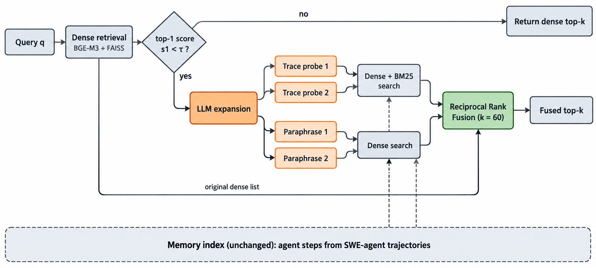

<div align="center">

# When Does Query Expansion Help Agent Memory?

**A Multi-Seed Study of Selective Expansion and Gate Reliability**

[Salomon Diei](https://salomon.reinvent-labs.com) · School of Computer Science and Engineering, KOREATECH

[](https://salomondiei08.github.io/sqe-experiment/)
[](https://salomondiei08.github.io/sqe-experiment/assets/sqe-paper.pdf)
[](https://huggingface.co/datasets/TheReinventGuy/sqe-experiment)
[](https://salomondiei08.github.io/sqe-experiment/talk/)

</div>

> **TL;DR** Expanding only low-confidence queries halves the cost of LLM query
> expansion for agent memory with no loss in Recall@5, but the confidence gate
> picks queries no better than chance. Gating, not expansion, is the open problem.

<p align="center"></p>

Long-horizon software agents store execution traces and later retrieve them with
natural-language questions, so the query and the memory are written in different
"languages". **Selective Query-Side Expansion (SQE)** expands a query with
hypothetical execution traces and paraphrases only when the top-1 dense retrieval
score is low, then fuses all rankings with Reciprocal Rank Fusion. The memory
store and both indices stay unchanged.

## Results

Eight resampled memory stores with rebuilt indices, 500 queries each
(4,000 queries over SWE-smith agent steps). Mean over seeds, %.

| Method | Recall@1 | Recall@5 | Recall@10 | Expanded |
| --- | ---: | ---: | ---: | ---: |
| Dense-Only | **45.5** | 68.5 | 74.2 | 0 |
| Hybrid-RRF | 32.5 | 63.5 | 71.8 | 0 |
| Always-Expand | 39.8 | 69.2 | **75.9** | 100 |
| Random-Gated-Expansion | 42.6 | 68.9 | 75.0 | 45.9 |
| **SQE (ours)** | 44.5 | **69.4** | 75.3 | 48.2 |

**What this shows**

1. **A small gain over dense retrieval at Recall@5, a loss at Recall@1.** The
   paired difference is +0.9 points (95% CI [+0.1, +1.7]); Recall@1 falls from
   45.5% to 44.5%. Seed-to-seed spread (±2.7 points) is three times the method effect.
2. **The gate is no better than random.** Against Random-Gated-Expansion at a
   similar budget, SQE gains +0.5 points (CI [−0.2, +1.1], p = 0.085).
3. **Selectivity still saves cost.** SQE uses 405 LLM tokens and 2.8 s per query
   versus 899 tokens and 5.4 s for Always-Expand (−55% tokens), at equal Recall@5.
4. **Little headroom for any gate.** An oracle gate reaches 73.5% Recall@5 against
   68.2% for dense retrieval: expansion helps 5.3% of queries and hurts 4.2%.

The [project page](https://salomondiei08.github.io/sqe-experiment/) has the
interactive per-seed view, paired tests, and all figures.

## Reproduce and verify

Every number in the paper is recomputed from released result files.

```bash
make help        # list targets
make verify      # recompute all metrics and check each table against its source
make readiness   # report which evidence is present and which is still missing
make paper       # rebuild and verify the paper package from existing evidence
```

Equivalent scripts:

```bash
python scripts/07_verify_experiment.py
python scripts/09_make_multiseed_report.py
python scripts/14_submission_readiness_check.py
python paper/preprint/make_figures.py   # regenerate figures from the released JSON
```

The full pipeline (dataset preparation, index building, baselines, SQE, evaluation)
is `scripts/01_prepare_dataset.py` through `scripts/06_make_paper_artifacts.py`.
Memory stores and per-query rows are on the
[Hugging Face dataset](https://huggingface.co/datasets/TheReinventGuy/sqe-experiment).

## Repository map

| Path | Contents |
| --- | --- |
| [`paper/`](paper/) | Single-column paper (`main.tex`), two-column preprint (`preprint/`), tables, figures, references |
| [`results/`](results/) | Per-seed summaries (seeds 42–49), multi-seed report, paired tests, gate calibration, token measurements |
| [`scripts/`](scripts/) | Numbered pipeline: preparation, retrieval, evaluation, verification, diagnostics |
| [`site/`](site/) | Source of the project page (static, no dependencies; deployed with GitHub Pages) |
| [`presentation/`](presentation/) | NAFSIK 2026 slides and speaker notes |
| [`human_audit/`](human_audit/) | 100-query audit packet and labeling protocol (labels not yet collected) |
| [`pass1_evoagentbench_configs/`](pass1_evoagentbench_configs/) | Prepared configs for future downstream Pass@1 runs (not yet executed) |
| [`docs/`](docs/) | Audits, manifests, and release notes |

## Limitations

- Evaluation queries are written by an LLM that sees the target trace; a
  human-audit packet is prepared but unlabeled.
- Only the exact source step counts as relevant, so Recall@k may understate all methods.
- Retrieval metrics only: downstream agent Pass@1 is not measured.
- Seeds share about 30% of their memories, so pooled intervals are likely too
  narrow; no multiplicity correction is applied.
- One embedder (bge-m3), one generator (Qwen3.6-35B-A3B), one trace source, one memory size.

## Citation

```bibtex
@misc{diei2026sqe,
  title  = {When Does Query Expansion Help Agent Memory? A Multi-Seed Study of Selective Expansion and Gate Reliability},
  author = {Diei, Salomon},
  year   = {2026},
  note   = {Preprint},
  url    = {https://github.com/Salomondiei08/sqe-experiment}
}
```

An earlier version of this work was presented at
[NAFSIK 2026](https://sites.google.com/view/nafsik?pli=1&authuser=0).

## Contact

Questions and collaboration: [salomon@koreatech.ac.kr](mailto:salomon@koreatech.ac.kr)
